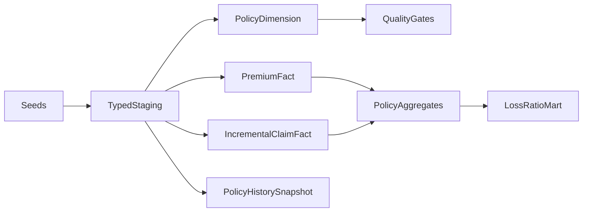

# Architecture and review guide

## Execution boundaries

A dbt/DuckDB warehouse implements typed staging, policy dimensions, premium and claim facts, incremental claim loads, policy SCD snapshots, data quality gates, and loss-ratio marts. Premiums and claims are aggregated at policy grain before joining, preventing fact-to-fact multiplication. dbt generates executable lineage and documentation artifacts.

## Decisions to review

Amounts use integer cents. The ratio is incurred losses divided by written premiums, not an actuarial earned-premium measure. This is analytics sample code, not accounting or regulatory reporting. Claim incremental loads require monotonic updated_at timestamps; a full refresh handles historical restatements. Snapshots capture observed changes only when dbt snapshot runs. DuckDB is a single-process local deployment; warehouse migration requires adapter-specific validation.

## Failure exercise

1. Run the supplied synthetic example and record its state or output.
2. Run the same input again. Inspect the replay policy: event/batch idempotency for transactional systems, stable latest-state results for CDC, pinned versions for contracts, and explicit output prefixes for Beam.
3. Introduce a malformed input and run the tests that exercise rejection. Check whether the contract requires quarantine or whole-batch failure before re-running.
4. Stop the persistence service during a write when using a deployed topology. Confirm that the consumer/scheduler does not advance its source checkpoint before the sink commits.
5. Recover from the retained input. Inspect receipts, rejects, run metadata, or comparison reports instead of assuming a successful process exit implies end-to-end correctness.

Steps requiring Kafka, PostgreSQL, Airflow, Spark, or containers are deployment exercises, not claims that those environments were tested here. See `VALIDATION.md` for executed evidence.

## Portfolio discussion

Be prepared to explain the input grain, key/version contract, transaction boundary, retained state, failure recovery, and the changes required for multiple workers or a cloud deployment. The implementation deliberately exposes these decisions rather than claiming scale from a small synthetic example.
